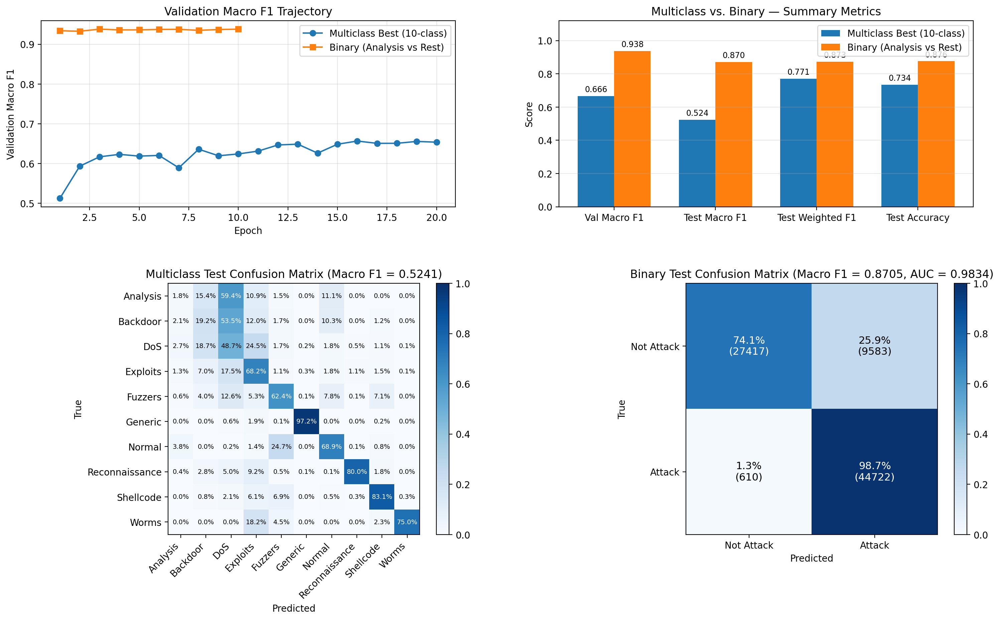
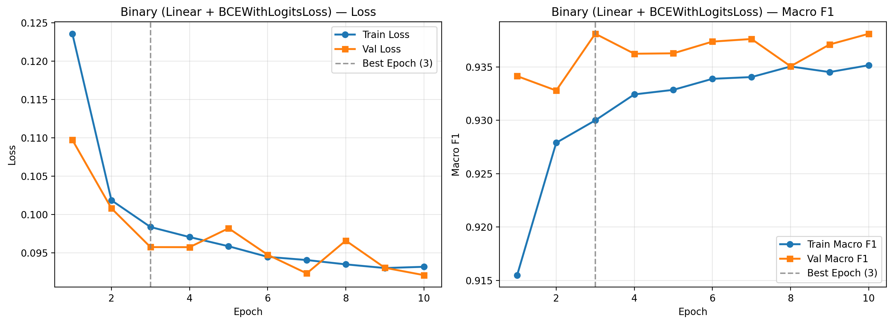
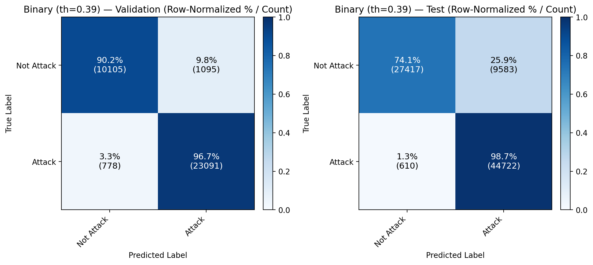
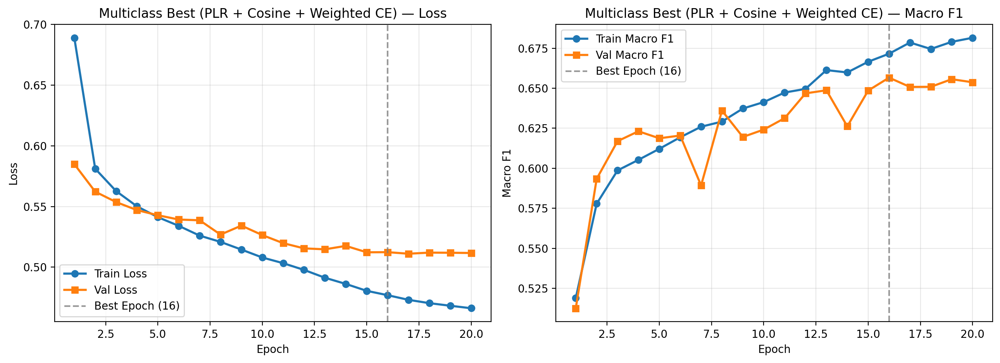
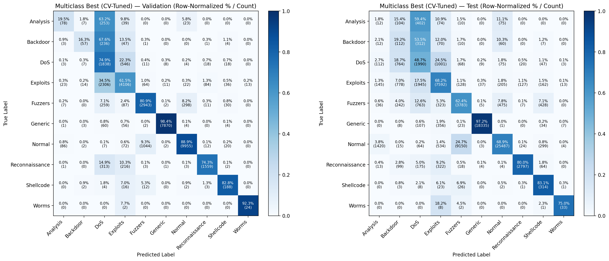

# Intrusion detection using transformers - Binary and Multiclass

## Problem

### What is network intrusion detection?
Intrusion detection is the process of monitoring computer systems and networks to identify activities that may compromise their security, such as unauthorized access, malicious behavior, or violations of established security policies. In the context of computer networks, Network Intrusion Detection Systems (NIDS) analyze network traffic to identify potentially malicious communications and security threats. These systems can employ different detection approaches, including signature-based detection, which relies on previously identified attack patterns, and anomaly-based detection, which identifies deviations from established representations of normal behavior. The effectiveness of intrusion detection is particularly important given the diversity of cyberattacks, whose characteristics and manifestations can vary significantly, making their identification a challenging task.

### Modelling intrusion detection
Network intrusion detection can be formulated as either a binary or a multiclass classification problem. In binary classification, network traffic is categorized as either normal or malicious, regardless of the specific attack type. In contrast, multiclass classification requires the identification of the specific category associated with each traffic record. This distinction introduces additional complexity, since different attack categories may exhibit similar behavioral characteristics, and some attacks may closely resemble normal network traffic. Consequently, a model capable of accurately detecting malicious activity may not necessarily be able to reliably distinguish between different attack types. Multiclass intrusion detection therefore requires the learning of more complex decision boundaries, making it a more challenging classification task.

### Anomaly detection vs signature-based vs supervised classification

Anomaly detection learns or defines normal behavior itself, and then detects deviations from it. An anomaly is not inherently malicious. Signature-based detection identifies patterns associated with known attacks. Supervised intrusion classification learns from labeled examples of normal traffic and then tries to predict the class of a new traffic record. This project falls into this third category, being trained and tested on the UNSW-NB15 dataset.

### Dataset

The UNSW-NB15 dataset was developed in 2015 by the Cyber Range Lab of the Australian Centre for Cyber Security at the University of New South Wales to support research on network intrusion detection. It combines normal network activities with synthetically generated contemporary attack behaviors, comprising records characterized by network traffic features, including flow-based, statistical, and protocol-related attributes. Nine different categories are included in the multiclass target label for this dataset: Fuzzers, Analysis, Backdoor, DoS, Exploits, Generic, Reconnaissance, Shellcode and Worms, besides normal traffic, for a total of 10 categories. The dataset provides predefined training and testing partitions, containing 175,341 and 82,332 records, respectively, making it a widely used benchmark for evaluating intrusion detection models.

## Implementation

### Dataset preparation and partitioning

The implementation uses the two predefined partitions provided by the UNSW-NB15 dataset, with 175,341 records in the training set and 82,332 records in the testing set. For the multiclass implementation, the `attack_cat` attribute is used as the target variable, whereas the binary implementation uses the `label` attribute to distinguish between normal and malicious traffic. In both cases, the remaining attributes are used as input features, excluding identifiers and redundant label information. The input consists of 42 features, comprising 39 numerical features and three categorical features: protocol (`proto`), service (`service`), and connection state (`state`). The original training partition is further divided into training and validation subsets using an 80/20 stratified split, resulting in 140,272 training records and 35,069 validation records. Stratification preserves the relative distribution of classes across the two subsets, allowing model training and validation under comparable class distributions. The predefined testing partition is kept separate from the training and validation procedures and is used for the final evaluation of the trained models.

### Feature preprocessing
1. Numerical features  

Numerical features are first transformed through logarithmic scaling when appropriate, standardized using the training-set statistics, and clipped to a predefined range to reduce the influence of extreme values. Since the Transformer operates on vector representations, each numerical feature is subsequently mapped to a 64-dimensional embedding through a feature-specific learned affine transformation. Each feature has its own trainable weight and bias vectors, allowing the model to learn distinct representations according to the semantic meaning of each attribute. This approach ensures that numerical features are represented individually rather than being treated as interchangeable scalar inputs.

2. Categorical features  

Categorical features require a different representation because their values represent discrete categories rather than numerical quantities. Directly encoding categories as integers could introduce artificial ordinal relationships between them, even though their numerical identifiers have no inherent mathematical meaning. To avoid this issue, each categorical feature is assigned a vocabulary index, which is subsequently mapped to a trainable embedding vector. Separate embedding tables are used for the protocol, service, and connection state features, allowing the model to learn feature-specific representations during training. An additional index is reserved for previously unseen categories, ensuring that values not encountered during training can still be represented.

3. Combining feature embeddings into tokens

After the individual feature embeddings are generated, they are concatenated to form a sequence of 42 tokens, each represented by a 64-dimensional vector. An additional learned feature identity embedding is added to each token to explicitly encode the identity of its corresponding original attribute. Unlike conventional positional encodings used in language Transformers, these embeddings do not represent sequential positions, since network traffic features have no inherent ordering. Instead, they allow the model to distinguish between different attributes and learn their relationships through subsequent self-attention operations. The resulting representation has dimensions $B \times 42 \times 64$, where $B$ denotes the batch size.

### Transformer architecture

1. Input representation  

The preprocessed numerical and categorical features are converted into 64-dimensional embeddings, resulting in 42 feature tokens per network traffic record. Each of the 39 numerical features is independently mapped through a learned affine transformation, while the three categorical features use separate learned embedding tables. A learned feature identity embedding is then added to each token to explicitly represent its corresponding original attribute. Unlike conventional positional encodings, these embeddings identify features rather than sequential positions, since network traffic attributes have no inherent ordering. The resulting representation has dimensions $B \times 42 \times 64$, where $B$ denotes the batch size.

2. Self attention  

The self-attention mechanism uses four parallel attention heads, each operating on a 16-dimensional representation. Each head independently computes Query, Key, and Value projections, allowing it to learn different relationships between network traffic features. Attention scores are calculated through scaled dot products between Queries and Keys, followed by a softmax operation that produces normalized attention weights. These weights determine how information from the Value representations is combined to generate contextualized feature representations. The outputs of the four heads are concatenated and passed through a final linear projection, producing a 64-dimensional representation for each of the 42 feature tokens.

3. Transformer encoder  

The Transformer encoder consists of four identical blocks, each containing a multi-head self-attention mechanism and a position-wise feed-forward network. Both sublayers employ Pre-Layer Normalization and residual connections. Layer Normalization is applied before each sublayer to stabilize the representations during training, while residual connections preserve information from previous representations and facilitate gradient propagation. Following self-attention, each token is independently processed by a feed-forward network consisting of two linear layers, with dimensions of 64, 128, and 64, respectively, and a ReLU activation between them. This combination allows the model to learn relationships between different network traffic features through attention and apply additional nonlinear transformations to their contextualized representations.

4. CLS token and classification  

To obtain a single representation for each network traffic record, the architecture incorporates a learnable classification token (CLS token), which is prepended to the sequence of 42 feature tokens. This increases the input sequence length to 43 tokens. Through the self-attention mechanism, the CLS token can attend to all feature tokens and progressively aggregate information from their representations across the encoder blocks. After the final encoder layer and Layer Normalization, the resulting CLS representation is extracted and passed through a linear classification layer. The output layer generates raw logits, with a single output for binary classification and ten outputs for multiclass classification. In the binary setting, the single logit is converted into an attack probability using the sigmoid function, whereas the multiclass model selects the class associated with the highest logit.  

### Numerical feature tokenization (PLR)  

The numerical feature representation was improved using a Periodic-Linear-ReLU (PLR) tokenizer, following the approach proposed by Gorishniy et al. (2022). Instead of directly mapping each numerical value through an affine transformation, the tokenizer first applies periodic transformations using learnable frequencies. For each numerical feature, 16 frequencies are used to generate sine and cosine components, resulting in a 32-dimensional periodic representation. The use of multiple frequencies allows the model to capture nonlinear patterns at different scales, while feature-specific frequency parameters enable different numerical attributes to develop distinct representations. The resulting vectors are subsequently projected into the 64-dimensional embedding space through learned linear transformations, followed by a ReLU activation. This produces one 64-dimensional token for each numerical feature, preserving the original Transformer architecture while providing a more expressive numerical representation.  

### Binary and multiclass setups

The binary and multiclass experiments are conducted independently, with separate model initialization and training procedures. Both models share the same input features and general Transformer architecture, including four encoder blocks, four attention heads, and a 64-dimensional embedding space. However, their numerical tokenization strategies differ: the binary model uses a linear numerical tokenizer, whereas the multiclass model employs the Periodic-Linear-ReLU (PLR) tokenizer. The classification objectives also differ. The binary model groups all nine attack categories into a single malicious class, while the multiclass model preserves the original ten categories. Consequently, each model independently learns its feature representations and classification boundaries according to its respective task.

The numerical tokenization strategy was selected independently for each classification task based on experimental evaluation. For binary classification, the linear tokenizer achieved better performance than the PLR tokenizer under the same model architecture and training configuration. Therefore, the linear tokenizer was retained for the final binary model. For multiclass classification, the PLR tokenizer was selected as the final numerical representation. This demonstrates that the most effective feature representation may depend on the classification objective.

### Training configuration  

Both models are trained using the AdamW optimizer, with an initial learning rate of $10^{-3}$ and a weight decay of $10^{-4}$. A batch size of 256 is used during training, while validation and testing use batches of 512 records. The binary model is trained for up to 10 epochs using Binary Cross-Entropy with Logits Loss (`BCEWithLogitsLoss`), incorporating a positive-class weight to account for class imbalance. The multiclass model is trained for up to 20 epochs using weighted Cross-Entropy Loss, with class weights derived from the training-set class distribution. Additionally, a cosine annealing learning-rate scheduler is employed in the multiclass experiment, gradually reducing the learning rate from $10^{-3}$ to $10^{-5}$ throughout training.

In both experiments, model performance is evaluated after each epoch using the validation set. Macro-averaged F1-score is used as the primary selection metric, and the model weights corresponding to the highest validation score are retained for final evaluation. This checkpoint selection strategy prioritizes balanced performance across classes rather than allowing majority classes to dominate the evaluation metric.

In the binary experiment, the model produces a single logit for each input record, which is converted into an attack probability through the sigmoid function. Rather than adopting the default classification threshold of 0.5, a threshold is selected using the validation set. The implementation evaluates 91 candidate thresholds uniformly distributed between 0.05 and 0.95 and selects the one that maximizes macro-averaged F1-score. This approach aims to balance the model's performance between normal and malicious traffic, giving equal importance to both classes regardless of their relative frequencies. The selected threshold is subsequently applied to the test predictions.

In the multiclass experiment, an additional post-processing strategy is employed to improve the recognition of minority attack categories. After training, class-specific logit offsets are estimated using five-fold stratified cross-validation on the validation predictions. These offsets are added to the model's original logits before the final class prediction is obtained through the argmax operation. By adjusting the relative scores assigned to different categories, this procedure aims to reduce the tendency of the classifier to favor more frequent classes. The resulting offsets are then applied to both validation and test predictions.

Accuracy and macro-averaged F1-score are emphasized according to the classification task. For binary classification, accuracy is the primary metric, while macro-F1 and ROC-AUC provide additional insight into class balance and discrimination performance. For multiclass classification, macro-F1 is the primary metric because it gives equal importance to all attack categories, regardless of their frequency. Accuracy and weighted-F1 are also reported to provide complementary measures of overall predictive performance.

## Results

### Overall performance comparison

The binary and multiclass Transformer models were evaluated on both the stratified validation subset (35,069 records) and the official UNSW-NB15 test partition (82,332 records). As expected, binary classification achieves substantially higher scores across all metrics than 10-class classification, reflecting the increased complexity of distinguishing between closely related attack categories.

| Model | Best Epoch | Val Macro-F1 | Test Macro-F1 | Test Weighted-F1 | Test Accuracy | Test ROC-AUC |
| :--- | :---: | :---: | :---: | :---: | :---: | :---: |
| **Binary Transformer** (Linear + BCE, $\text{th}=0.39$) | 3 | 0.938 | 0.8705 | 0.8731 | 0.8762 | 0.9834 |
| **Multiclass Transformer** (PLR + Cosine + Weighted CE + CV Offsets) | 16 | 0.666 | 0.5241 | 0.7710 | 0.7340 | — |

### Binary classification results

1. **Training dynamics**  
   Using the linear numerical tokenizer and weighted `BCEWithLogitsLoss`, the binary model converges rapidly, reaching its peak validation macro-F1 of **0.938** at **Epoch 3** before validation loss begins to fluctuate slightly. Selecting the Epoch 3 checkpoint prevents overfitting while preserving strong generalization.

2. **Threshold optimization and error analysis**  
   Validation threshold tuning selected an optimal decision threshold of **0.39** (rather than the default 0.50) to maximize macro-F1.
   - **Validation set:** The model correctly identifies **96.7%** of malicious traffic (23,091 / 23,869) and **90.2%** of normal traffic (10,105 / 11,200).
   - **Test set:** Generalization to the unseen test partition yields a strong ROC-AUC of **0.9834**, a macro-F1 of **0.8705**, and an exceptionally high attack recall of **98.7%** (44,722 / 45,332 attacks detected, missing only 610 attack records). However, the lower threshold shifts the precision-recall trade-off on the test distribution, resulting in **25.9%** of normal traffic (9,583 / 37,000) being flagged as false positives. In network intrusion detection, this trade-off favors minimizing missed intrusions (false negatives) at the cost of higher alert volume.

### Multiclass classification results  

1. **Training dynamics**  
   With the Periodic-Linear-ReLU (PLR) numerical tokenizer, class-weighted Cross-Entropy loss, and cosine annealing learning-rate schedule, the multiclass model exhibits steady convergence over 20 epochs. Training loss decreases smoothly from ~0.69 to ~0.46, while validation loss plateaus around ~0.51. Validation macro-F1 peaks at **Epoch 16** (**0.657** pre-tuning; **0.666** after 5-fold cross-validated logit offset adjustment), after which training F1 continues rising without validation gains.

2. **Per-class performance and confusion patterns**  
   On the test set, the multiclass model achieves **73.4%** accuracy, **0.771** weighted-F1, and **0.5241** macro-F1. The gap between weighted-F1 and macro-F1 highlights uneven performance across frequent versus minority or overlapping attack classes:
   - **High-recall categories:** `Generic` (**97.2%**), `Shellcode` (**83.1%**), `Reconnaissance` (**80.0%**), `Worms` (**75.0%**), and `Exploits` (**68.2%**) are reliably identified on the test set. Notably, the PLR tokenizer and logit-offset tuning allow the model to recover rare categories such as `Worms` (33 / 44 test records) and `Shellcode` (314 / 378 test records) despite extreme class scarcity.
   - **Primary confusion clusters:**
     - **DoS / Analysis / Backdoor overlap:** `Analysis` (1.8% test recall) and `Backdoor` (19.2% test recall) are heavily misclassified as `DoS` (59.4% and 53.5%, respectively) and `Exploits` (10.9% and 12.0%). Similarly, `DoS` traffic is frequently confused with `Exploits` (24.5%) and `Backdoor` (18.7%). These categories share similar volumetric and protocol-level flow characteristics in UNSW-NB15, making fine-grained separation difficult from flow features alone.
     - **Normal vs. Fuzzers boundary:** On the test set, **68.9%** of `Normal` traffic is correctly classified, while **24.7%** (9,150 records) is misclassified as `Fuzzers`. Because fuzzing attacks send malformed or semi-valid inputs that closely resemble legitimate protocol interactions, the logit-offset boost applied to improve minority attack recall increases false-positive spillover from `Normal` into `Fuzzers`.

### Summary of findings

- **Task-dependent numerical representations:** Linear feature embeddings are sufficient and generalize better for binary intrusion detection, whereas periodic embeddings (PLR) provide the nonlinear resolution required to separate fine-grained multiclass attack signatures.
- **High detection sensitivity vs. fine-grained attribution:** Combining binary detection (98.7% attack recall, 0.9834 ROC-AUC) with multiclass classification demonstrates a practical two-stage tradeoff: the Transformer reliably separates malicious traffic from normal activity, while multiclass attribution succeeds on distinct attack signatures (`Generic`, `Shellcode`, `Reconnaissance`, `Worms`) and encounters expected boundary overlap among behaviorally similar classes (`Analysis`, `Backdoor`, `DoS`, `Exploits`).

### Future work
1. **Hierarchical two-stage classification**  
   Instead of treating binary and multiclass detection as completely isolated pipelines, a two-stage hierarchical architecture could first filter traffic using the high-recall binary Transformer (`98.7%` attack recall) and route only flagged records to a specialized 9-class attack classifier. Removing the dominant `Normal` class from the second stage would eliminate `Normal`–`Fuzzers` confusion and allow the multiclass encoder to focus exclusively on separating attack signatures.

2. **Loss functions for hard-to-separate minority classes**  
   Replacing standard class-weighted Cross-Entropy with Focal Loss or Label-Distribution-Aware Margin (LDAM) loss could encourage wider decision margins around overlapping minority classes (`Analysis`, `Backdoor`, and `Worms`) during training, reducing reliance on aggressive post-hoc logit offsets.

3. **Temporal and session-level modeling**  
   Extending the feature-token Transformer to incorporate sequences of consecutive flows grouped by source/destination IP and time window would enable the model to capture multi-packet attack patterns—such as slow reconnaissance scans, persistent backdoor beaconing, and sustained DoS bursts—that are ambiguous in isolated flow records.

4. **Cross-dataset generalization**  
   Evaluating the PLR-Transformer architecture on newer benchmark datasets such as CIC-IDS2017, CSE-CIC-IDS2018, or TON_IoT would verify how well feature-tokenized self-attention transfers across modern network topologies and encrypted traffic profiles.

## References

1. **UNSW-NB15 Dataset**  
   Moustafa, N., & Slay, J. (2015). *UNSW-NB15: A comprehensive data set for network intrusion detection systems (UNSW-NB15 network data set)*. 2015 Military Communications and Information Systems Conference (MilCIS), 1–6. https://doi.org/10.1109/MilCIS.2015.7348942

2. **UNSW-NB15 Statistical Evaluation**  
   Moustafa, N., & Slay, J. (2016). *The evaluation of Network Anomaly Detection Systems: Statistical analysis of the UNSW-NB15 data set and the comparison with the KDD99 data set*. Information Security Journal: A Global Perspective, 25(1–3), 18–31. https://doi.org/10.1080/19393555.2015.1125974

3. **Feature Tokenizer Transformer (FT-Transformer)**  
   Gorishniy, Y., Rubachev, I., Khrulkov, V., & Babenko, A. (2021). *Revisiting Deep Learning Models for Tabular Data*. Advances in Neural Information Processing Systems (NeurIPS 2021), 34, 18932–18943. https://arxiv.org/abs/2106.11959

4. **Periodic-Linear-ReLU (PLR) Numerical Embeddings**  
   Gorishniy, Y., Rubachev, I., & Babenko, A. (2022). *On Embeddings for Numerical Features in Tabular Deep Learning*. Advances in Neural Information Processing Systems (NeurIPS 2022), 35, 24991–25004. https://arxiv.org/abs/2203.05556

5. **Transformer Architecture**  
   Vaswani, A., Shazeer, N., Parmar, N., Uszkoreit, J., Jones, L., Gomez, A. N., Kaiser, Ł., & Polosukhin, I. (2017). *Attention Is All You Need*. Advances in Neural Information Processing Systems (NeurIPS 2017), 30, 5998–6008. https://arxiv.org/abs/1706.03762

6. **AdamW Optimizer & Cosine Annealing**  
   Loshchilov, I., & Hutter, F. (2019). *Decoupled Weight Decay Regularization*. International Conference on Learning Representations (ICLR 2019). https://arxiv.org/abs/1711.05101